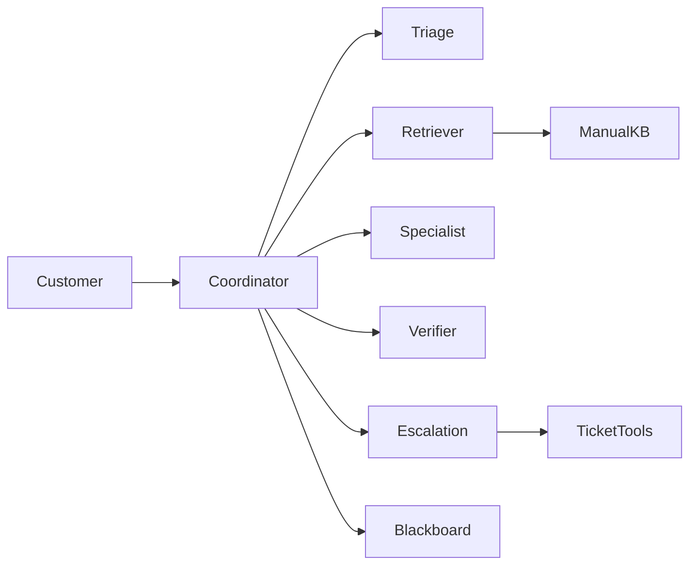

# Lab 4 Report — Multi-Agent MycoVault MV-200 Helpdesk

**Course:** Multi-Agent Systems (MAS)  
**Stack:** Python, Ollama (`llama3.1:8b`, `nomic-embed-text`), NumPy  
**Default settings:** chunk size 900, overlap 150, RAG k=4, Retriever k=5, τ=0.50

---

## 1. Architecture



Agents exchange `Message(sender, receiver, performative, content, ts)` on a shared blackboard. The coordinator routes messages and enforces retries / escalation. Empty retrieval or `NOT_IN_MANUAL` never invents an answer.

**B2 cache:** embeddings are stored under `.cache/kb_<chunksize>.npy` + `.json`, keyed by the manual’s SHA-256. Rebuild only if the manual or chunk size changes.

**CLI / history (C2):** `python coordinator.py --trace` keeps conversation history so follow-ups work. Example from a live run: after “My display shows E07…”, the user asked “and how long does that take?”; Triage rewrote it to “How long does recalibration take?” and the system answered **8 minutes** from Section 7.

---

## 2. Agent prompts

Full prompts live in `agents.py` / `baseline.py`. Quoted below.

### Baseline (Part A)

> You are a helpful customer-support agent for the MycoVault MV-200 mushroom growing cabinet.

### Single RAG (Part B3)

> Answer ONLY from the manual excerpts given between `<context>` and `</context>`. Cite section names as `[Section: <name>]`. Do not add facts not in the context. If the context does not contain the answer, reply exactly: `NOT_IN_MANUAL`.

### Triage

> You classify customer messages for the MycoVault MV-200 helpdesk. Return ONLY JSON with keys: intent (troubleshooting | cultivation | maintenance | safety | warranty | off_topic), urgency (low|medium|high), error_code (e.g. 'E07' or null), species (or null), standalone_question (rewritten to be self-contained). Use conversation history for follow-ups. Device/firmware/warranty questions are never off_topic. Smoke, burning smell or water leaks → safety, high urgency.

### Retriever

> You write search queries for the MycoVault MV-200 manual. Return ONLY JSON `{"queries": [...]}` with 2 or 3 short alternative queries using technical-manual vocabulary (components, error codes, procedures).

### Specialist (base + intent variants)

> Write the reply using ONLY CONTEXT. Cite `[Section: <name>]`. Never invent numbers/part numbers/durations/buttons. If unanswered by context: `NOT_IN_MANUAL`. At most 6 sentences.

Intent add-ons: troubleshooting → meaning + numbered steps; safety → urgent protective action first; maintenance → intervals/products/never-use; cultivation → exact profile values; warranty → rules that void warranty.

### Verifier

> Strict fact checker. CONTEXT + DRAFT → ONLY JSON `{"supported": true|false, "unsupported_claims": [...], "missing_safety_warning": true|false, "feedback": "..."}`.

### Escalation (`ESCALATION_POLICY`)

> Ticket only for Section 9: (1) E19 twice / 24 h → medium; (2) E23 not clear in 10 min → high; (3) E07 back within 7 days after recalibration → medium; (4) burning smell / smoke / water leak → high, unplug. Otherwise no ticket. May call `lookup_error_code`. If ticket needed, call `create_ticket` once. Tools are validated by guardrails in `tools.py` before execution.

---

## 3. Part A / B observations

### Baseline hallucinations (Part A)

Without the manual, answers are fluent but invented, e.g. Q9 vinegar soak (manual: 5 % citric + CLEAN); Q10 “E12 LED base” (manual: SporeEye contamination / Quarantine). See §8 Part A reflections.

### Retrieval demo (Task B1) — `results/partB1_retrieval.txt`

| Query | Top section | Score |
|-------|-------------|-------|
| E07 | 7. Error Codes | 0.627 |
| lion's mane humidity | 5. Cultivation Profiles | 0.666 |
| bleach | 5. Cultivation Profiles | 0.498 |

“bleach” does **not** hit Maintenance first (failure case §7.1).

### Single RAG (B3) on Q1–10 — `results/partB3_rag.json`

9/10 grounded correctly. Q6 (5 GHz router) once returned `NOT_IN_MANUAL` (retrieval miss of 2.4 GHz).

### Tau sweep — `results/tau_sweep.md`

| τ | hit@5 (in-manual) | mean chunks kept |
|---|---|---|
| 0.40 | 17/18 | 5.0 |
| 0.45 | 17/18 | 5.0 |
| **0.50** | **17/18** | **4.7** |
| 0.55 | 16/18 | 3.1 |

Chosen **τ = 0.50**. Q18 (Psilocybe) still scores ~0.75 at top → refusal must come from Specialist / `NOT_IN_MANUAL`, not empty retrieval.

---

## 4. D1 demo traces (tools / escalation)

Summary + one full blackboard excerpt. All three runs: [`results/d1_traces.md`](results/d1_traces.md).

| Case | Question | Ticket |
|------|----------|--------|
| No ticket | My display shows E07… | none (`lookup_error_code` only) |
| Medium | I got E19 this morning and again now. | medium |
| High | Water under cabinet + burning smell | high + unplug |

### Example blackboard — no ticket (E07)

```
[triage -> coordinator] inform
    intent: troubleshooting  urgency: high  error_code: E07
    standalone_question: What should I do if my display shows E07?
[retriever -> coordinator] inform
    queries: [... "E07 error code" ...]
    chunks: Error Codes / Warranty / ...
[specialist -> coordinator] propose
    draft: ... fresh air ... FAN + LIGHT 5 s ... 8 minutes.
[verifier -> coordinator] inform
    supported: true
[escalation -> coordinator] inform
    ticket: null
    tool_calls: lookup_error_code(E07) allowed
[coordinator -> user] inform
    reply: (same grounded steps, no ticket)
```

---

## 5. E1 evaluation (20 questions, `llama3.1:8b`)

Source: [`results/eval_table.md`](results/eval_table.md), raw JSON `results/eval_llama3.1-8b.json`.

| Metric | Baseline | Single RAG (B3) | Multi-agent |
|---|---|---|---|
| Fact accuracy (string match) | 18 % | 73 % | **83 %** |
| Fact accuracy (LLM judge) | 23 % | 59 % | **60 %** |
| Refusal correctness (Q18, Q20) | 0 % | **100 %** | **100 %** |
| False refusals on in-manual questions | 0 | 2 | 1 |
| Escalation precision | n/a | n/a | **1.00** |
| Escalation recall | 0.00 | 0.00 | **0.50** |
| Escalation F1 | n/a | n/a | **0.67** |
| Ticket priority correct | n/a | n/a | **2/2** |
| Retrieval hit@k | n/a | 94 % | **100 %** |
| Mean latency (s / question) | 3.13 | **0.66** | 4.00 |
| Mean LLM calls / question | 1.00 | 1.00 | 4.95 |

Grounding beats baseline. MAS is slower/costlier than single RAG but improves facts, hit@k, and adds escalation (perfect precision on tickets opened).

### Per-question snapshot

| Q | baseline | rag | mas | MAS ticket | gold section hit |
|---|---|---|---|---|---|
| 1 | 0/4 | 4/4 | 4/4 | - | yes |
| 2 | 0/1 | 0/1 | 1/1 | - | yes |
| 3 | 0/5 | 3/5 | 3/5 | - | yes |
| 6 | 1/1 | 0/1 | 1/1 | - | yes |
| 11 | 0/2 | 2/2 | 1/2 | medium | yes |
| 12 | 0/2 | 1/2 | 1/2 | - | yes |
| 13 | 1/2 | 0/2 | 2/2 | high | yes |
| 14 | 0/1 | 1/1 | 1/1 | - | yes |
| 18 | answered | refused | refused | - | n/a |
| 20 | answered | refused | refused | - | n/a |

Full 20-row table: `results/eval_table.md`.

---

## 6. E2 ablation — Verifier on vs off

Same `llama3.1:8b` (no second model / VRAM swap). Source: [`results/ablation_verifier.md`](results/ablation_verifier.md). ON = E1 MAS run.

| Metric | Verifier ON | Verifier OFF |
|---|---|---|
| Fact accuracy (string match) | 83 % | 82 % |
| Fact accuracy (LLM judge) | 60 % | 63 % |
| Refusal correctness | 100 % | 100 % |
| Escalation F1 | 0.67 | 0.67 |
| Mean latency (s) | 4.00 | **2.81** |
| Mean LLM calls | 4.95 | **3.90** |

### Accuracy / latency trade-off

OFF saves ~1.2 s and ~1 call/question (~30 % latency) with almost the same fact scores. Escalation is unchanged (Section 9 tools/guardrails). On this small set the Verifier does not raise mean accuracy; its role is safety filtering / revisions. Keep ON if latency allows; OFF for cheaper demos.

---

## 7. Failure cases

### 1. Retrieval ranking for “bleach” (B1)

Dense search ranked Cultivation / Warranty / Safety above Maintenance. Rare keywords need expansion or hybrid BM25.

### 2. Escalation recall (Q12 / Q14)

Gold tickets for E23 > 10 min and E07 back after recalibration were missed (recall 0.50, precision 1.00). Guardrails only block bad tickets; they do not force missing ones.

### 3. Partial facts / false refusal

Some answers miss key facts even with the right section (e.g. Lion’s Mane FAN level). RAG had 2 false refusals on in-manual questions — grounding can over-refuse when context is incomplete.

---

## 8. Reflection questions

### Part A — baseline (Q1–10)

**1. How many correct / confidently wrong?**  
~0 fully correct. A couple vaguely right (bleach / tap water) with wrong details; ~8–10 confidently wrong.

**2. Did it say “I don’t know”? Why rare?**  
No. Helpful-completion training + support prompt → fluent guessing beats refusal.

**3. Dangerous wrong answers?**  
Safety: wrong E07/E12 (misses Quarantine/FFP2); bleach without CO₂-sensor warning. Warranty/money: “5-year warranty”; vinegar descaling; wrong humidity/filter intervals.

### Report (deliverable)

**1. MAS vs pipeline?**  
Own goals/prompts per agent; FIPA-style blackboard messages; coordinator policy can reject / short-circuit — not a fixed call chain.

**2. Verifier value / cost?**  
Catches unsupported claims & missing safety; on this set mean facts barely change when off. Cost ~+1 call and ~+1.2 s/question (E2).

**3. Same model Verifier weakness?**  
Shared blind spots. Mitigate: stronger/different judge, rule checks vs chunks, require cited spans.

**4. Prompt injection via a chunk?**  
Injected CONTEXT can steer Specialist/Verifier. Defend: untrusted-data delimiters, strip instruction-like lines, cite spans only, ticket tools behind Section 9 guardrail.

---

## 9. How to reproduce

See [`README.md`](README.md).

```powershell
python kb.py --demo
python baseline.py --part A
python baseline.py --part B3
python coordinator.py --demo-d1
python evaluate.py --tau-sweep
python evaluate.py
python evaluate.py --ablation verifier
```

Artefacts: `results/partA_baseline.json`, `partB3_rag.json`, `partB1_retrieval.txt`, `d1_traces.md`, `eval_table.md`, `eval_llama3.1-8b.json`, `ablation_verifier.md`, `tau_sweep.md`.
